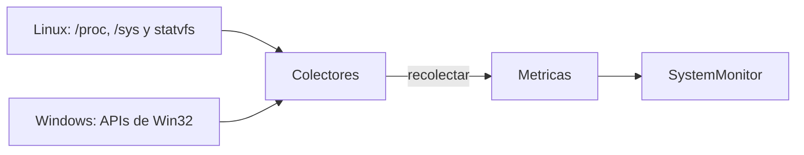

# Colectores: arquitectura y ciclo de vida

> Para agregar un colector nuevo, ver [collectors.md](collectors.md).

## Visión general

El subsistema de recolección obtiene métricas del sistema operativo. Cada
categoría de métrica (CPU, memoria, disco, red, etc.) se lee desde una fuente
del sistema y se normaliza antes de entregarse al resto de ChuspaPulse. La
interfaz `ICollector` define el contrato común: `SystemMonitor` mantiene una
lista de colectores registrados y los invoca sin conocer sus detalles internos.

## Implementaciones de `ICollector`

- **Clases propias**: batería, CPU, disco, memoria y red implementan
  `ICollector` directamente. Linux y Windows tienen implementaciones
  separadas en `src/platform/`.
- **Adaptadores en `main.cpp`**: procesos, carga promedio, uptime y temperatura
  están implementados como funciones y se envuelven en clases que heredan de
  `ICollector` (`CollectorProcesos`, `CollectorLoadAvg`, `CollectorUptime` y
  `CollectorTemperatura`).
- **Registro**: cada colector se registra con
  `SystemMonitor::addCollector()`.

## Flujo de datos



## La interfaz `ICollector`

Definida en `src/collectors/icollector.hpp`:

```cpp
class ICollector {
 public:
  virtual ~ICollector() = default;
  virtual std::string nombre() const = 0;
  virtual std::vector<core::Metrica> recolectar() = 0;
};
```

- **`nombre()`**: devuelve el identificador del colector (por ejemplo, `"cpu"`).
- **`recolectar()`**: ejecuta una medición y devuelve las métricas obtenidas.
  Si la medición falla, lanza una excepción.
- **Destructor virtual**: permite destruir colectores a través de un puntero a
  `ICollector`.

### Manejo de errores

La interfaz documenta que `recolectar()` lanza `ErrorRecoleccion`
(`src/collectors/error_recoleccion.hpp`), que extiende `std::runtime_error` y se
puede construir con un mensaje o con un código `errno`. Algunas funciones de
lectura (uptime, carga promedio, disco) lanzan directamente `std::runtime_error`
cuando la fuente no existe o tiene un formato inválido.

## Ciclo de vida de una recolección

1. Al iniciar, los colectores se crean y se registran en `SystemMonitor` con
   `addCollector()`.
2. En cada ciclo, `SystemMonitor` invoca `recolectar()` en cada colector
   registrado.
3. El colector lee su fuente del sistema. Para métricas que dependen del
   tiempo, como el uso de CPU, toma dos lecturas separadas por un intervalo
   corto y trabaja con la diferencia.
4. Normaliza los valores (porcentajes, bytes, etc.) y devuelve un vector de
   `Metrica` (nombre, valor y unidad).
5. Si la fuente no está disponible o su formato es inválido, lanza una
   excepción.

## Fuentes del sistema por colector

| Colector | Linux | Windows |
|----------|-------|---------|
| CPU (`cpu.usage`, `cpu.cores`) | `/proc/stat` | `GetSystemTimes`, `GetSystemInfo` |
| Memoria | `/proc/meminfo` | Sin implementación específica |
| Disco | `statvfs` sobre el punto de montaje `/` | Sin implementación específica |
| Red | `/proc/net/dev` | Sin implementación específica |
| Carga promedio | `/proc/loadavg` | Sin implementación específica |
| Procesos (totales) | `/proc/stat` y `/proc/loadavg` | Sin implementación específica |
| Top de procesos | `/proc` (listado de PID), `/proc/[pid]/stat`, `/proc/[pid]/status` (`VmRSS`) y `/proc/meminfo` | Sin implementación específica |
| Batería | `/sys/class/power_supply/BAT0` | Sin implementación específica |
| Temperatura | `/sys/class/thermal/thermal_zone0/temp` | Sin implementación específica |
| Uptime | `/proc/uptime` | `GetTickCount64` |

### CPU

- **Linux**: lee la primera línea de `/proc/stat` dos veces y calcula
  `100 * (1 - delta_idle / delta_total)`, donde idle incluye `iowait`. Cuenta los
  cores contando las líneas `cpuN`.
- **Windows**: llama dos veces a `GetSystemTimes`. En Windows el tiempo de kernel
  ya incluye el idle, por lo que el total es `delta_kernel + delta_user`. Los
  cores se obtienen con `GetSystemInfo`.
